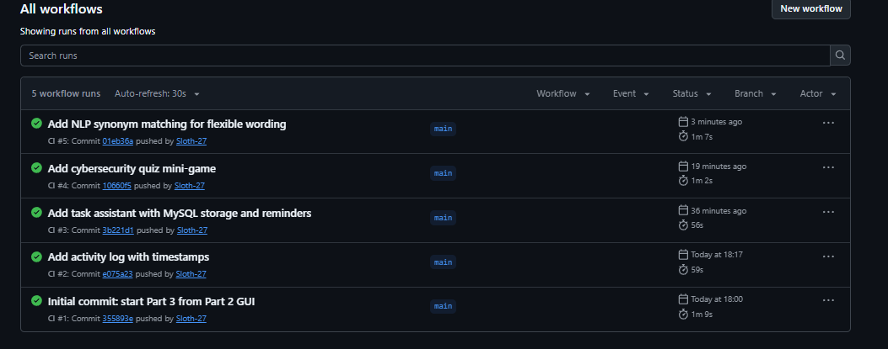

# Cybersecurity Awareness Bot (Part 3 / POE)

A WinForms chatbot that teaches users about cybersecurity.

## Features
- Voice greeting and ASCII art header
- Keyword recognition and random tips (password, phishing, scam, privacy)
- Memory of the user's name and favourite topic
- Sentiment detection (worried, curious, frustrated)
- Task assistant with reminders, stored in a MySQL database
- Cybersecurity quiz (13 questions, multiple choice and true/false)
- NLP simulation using synonyms and keyword detection
- Activity log with timestamps

## How to run
1. Install the .NET SDK and MySQL Server
2. Create the database: run `CREATE DATABASE chatbot_db;` then create the `tasks` table (see below)
3. Set your MySQL password in `TaskManager.cs`
4. Run `dotnet run` in the project folder

## Database setup
```sql
CREATE TABLE tasks (
    id INT AUTO_INCREMENT PRIMARY KEY,
    title VARCHAR(200) NOT NULL,
    description VARCHAR(500),
    reminder_date DATE NULL,
    is_completed BOOLEAN NOT NULL DEFAULT FALSE
);
```

## CI Status
